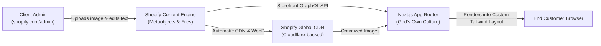
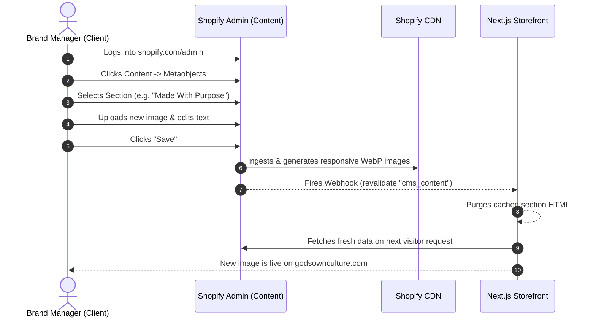

# Headless CMS Architecture & Implementation Report: Shopify Metaobjects for God's Own Culture

**Document ID:** GOC-CMS-REP-01  
**Target:** Future Implementation Roadmap  
**Scope:** Client-Facing Content Management System (Banners, Lookbook, Custom Pages & Section Media)  
**Author:** Engineering Team  
**Status:** Approved Blueprint for Implementation  

---

## 1. Executive Summary

This report provides the architectural blueprint, schema designs, and technical integration plan for giving the God's Own Culture management team full visual content control over the storefront without editing code or risking layout breaks.

Instead of deploying a separate headless CMS platform (such as Payload CMS, Strapi, or Sanity)—which introduces external database hosting, additional monthly SaaS costs, second logins, and cold-start connection management—this solution leverages **Shopify Metaobjects and Metafields** exposed via the **Shopify Storefront GraphQL API**.



### Core Value Proposition

1. **Zero Additional Infrastructure & \$0 Extra Cost:** Runs entirely inside the existing Shopify subscription. No MongoDB cluster, no PostgreSQL database, and no Cloudflare R2/S3 storage bucket to provision, secure, or maintain.
2. **One Unified Client Login:** The client already logs into `shopify.com/admin` to review orders and manage inventory. All website banners, stories, and images are managed directly within the same dashboard under **Content $\rightarrow$ Metaobjects**.
3. **High-Performance Global CDN:** Uploaded assets are automatically distributed across Shopify's global edge CDN with automatic WebP/AVIF compression and responsive downscaling.
4. **Layout & Responsive Immutability:** The client only provides raw assets (images and text strings). The Next.js React components strictly govern aspect ratios, container padding, typography, dark/light contrast, and mobile responsiveness. The client cannot break the design.

---

## 2. Comparative Analysis: Shopify Metaobjects vs Traditional CMS

| Evaluation Criteria | Shopify Metaobjects (Recommended) | Payload CMS 3.0 | Sanity.io / Strapi |
| :--- | :--- | :--- | :--- |
| **Hosting & Maintenance** | **Zero Maintenance** (Hosted natively by Shopify) | Self-hosted inside Next.js (Requires server maintenance) | Third-party cloud platform |
| **Database Requirement** | **None** (Built into Shopify core) | Requires external MongoDB or PostgreSQL database | Managed by SaaS |
| **Media & Image Storage** | **Unlimited on Shopify CDN** (No egress costs) | Requires S3 / Cloudflare R2 bucket configuration | Included up to SaaS quota |
| **Client Authentication** | **Existing Shopify Admin** (Single Sign-On) | Separate `/admin` login and credentials to manage | Separate third-party account |
| **Custom Design Support** | **100% Compatible** (Headless query into Next.js components) | 100% Compatible | 100% Compatible |
| **Cost** | **\$0.00 / month** | Free software; \$5–\$15/mo for DB & storage | Free tier, then \$99+/mo |
| **E-commerce Native Linking** | **Direct Catalog Links** (Pick products from dropdown) | Requires custom synchronization logic | Requires custom Shopify plugin |

---

## 3. Schema Design & Target Content Modules

To power the custom components on the storefront, five distinct Metaobject definitions will be established in Shopify.

### Module 1: "Made With Purpose" Section
* **Location on Storefront:** Homepage boxy-cut luxury specification block.
* **Component File:** `components/MadeWithPurpose.tsx` (or related hero section).
* **Metaobject Type:** `section_made_with_purpose`

| Field Handle | Field Type | Purpose | Validation Rules |
| :--- | :--- | :--- | :--- |
| `background_image` | File (Image) | High-resolution editorial lifestyle photograph | Required, Recommended 2400x1600px |
| `badge_text` | Single line text | Micro-badge (e.g. "BOX-FIT LUXURY") | Max 30 chars |
| `headline` | Single line text | Main section title | Max 60 chars |
| `body_copy` | Multi-line text | Brand narrative on fabric, GSM, and fit | Max 350 chars |
| `bullet_points` | List of single line text | Key specifications (e.g. "260 GSM Heavyweight Cotton") | 3 to 5 items |

---

### Module 2: "Shop The Look" / Lookbook Carousel
* **Location on Storefront:** Homepage interactive lookbook.
* **Component File:** `components/ShopTheLook.tsx`
* **Metaobject Type:** `lookbook_item`

| Field Handle | Field Type | Purpose | Validation Rules |
| :--- | :--- | :--- | :--- |
| `look_title` | Single line text | Title of the styled look (e.g. "Minimalist Street") | Required, Max 50 chars |
| `model_photo` | File (Image) | Full-bleed model photograph | Required, Portrait (3:4 ratio) |
| `mobile_photo` | File (Image) | Cropped alternative for mobile displays (optional) | Optional |
| `tagged_products` | List of Product References | Products worn in the photo for 1-click cart addition | 1 to 4 Shopify products |
| `display_order` | Integer | Sorting position in the slider | Default: 1 |

---

### Module 3: "About Page" Narrative & Philosophy
* **Location on Storefront:** `/about`
* **Component File:** `components/pages/AboutPage.tsx`
* **Metaobject Type:** `page_about_us`

| Field Handle | Field Type | Purpose | Validation Rules |
| :--- | :--- | :--- | :--- |
| `hero_image` | File (Image) | Top full-width atmospheric banner | Required, 2880x1200px |
| `mission_headline` | Single line text | Primary philosophical declaration | Max 100 chars |
| `mission_description` | Rich text / Multi-line | Long-form story of the God's Own Culture identity | Paragraph formatting |
| `culture_gallery` | List of Files (Images) | Grid of 4 to 6 Kerala-inspired culture shots | Exactly 4 or 6 images |
| `quote_text` | Single line text | Standout pull quote | Max 150 chars |
| `quote_author` | Single line text | Citation (e.g. "Founder, God's Own Culture") | Max 40 chars |

---

### Module 4: "Culture Duo" & Promotional Banners
* **Location on Storefront:** Homepage combo banner.
* **Component File:** `components/CultureDuoBanner.tsx`
* **Metaobject Type:** `promo_banner_duo`

| Field Handle | Field Type | Purpose | Validation Rules |
| :--- | :--- | :--- | :--- |
| `desktop_banner` | File (Image) | Horizontal desktop composition | Required, 1920x800px |
| `mobile_banner` | File (Image) | Mobile composition preventing face crop | Required, 1086x1448px |
| `tag_label` | Single line text | Accent tag (e.g. "BUNDLE OFFER") | Max 25 chars |
| `heading` | Single line text | Main headline (e.g. "THE CULTURE DUO") | Max 40 chars |
| `subheading` | Multi-line text | Descriptive hook | Max 120 chars |
| `combo_price` | Single line text | Display bundle price (e.g. "₹1,349") | Formatted currency |
| `mrp_price` | Single line text | Original MRP strikethrough (e.g. "₹1,698") | Formatted currency |
| `target_link` | URL / Single line text | Destination URL on click (e.g. `/products/the-culture-duo`) | Required path |

---

### Module 5: Instagram & Editorial Community Grid
* **Location on Storefront:** Homepage footer community feed.
* **Component File:** `components/InstagramFeed.tsx`
* **Metaobject Type:** `social_feed_item`

| Field Handle | Field Type | Purpose | Validation Rules |
| :--- | :--- | :--- | :--- |
| `media_image` | File (Image) | Clean 1:1 square Instagram feed visual | Required, 1080x1080px |
| `caption` | Single line text | Hover alt text / accessible description | Max 100 chars |
| `instagram_url` | Single line text | Direct link to Instagram post / reel | Standard URL |
| `display_order` | Integer | Column position (1 to 6) | 1 to 6 |

---

## 4. Next.js Technical Architecture & Code Blueprint

### 4.1. Storefront GraphQL Query (`lib/cmsMetaobjects.ts`)
A centralized query module will query Shopify Storefront API using the existing `storefrontClient`:

```ts
// lib/cmsMetaobjects.ts
const CMS_CONTENT_QUERY = `
  query GetStorefrontCMSContent {
    madeWithPurpose: metaobjects(type: "section_made_with_purpose", first: 1) {
      nodes {
        fields {
          key
          value
          reference {
            ... on MediaImage {
              image {
                url
                altText
                width
                height
              }
            }
          }
        }
      }
    }
    lookbook: metaobjects(type: "lookbook_item", first: 10, sortKey: "updated_at") {
      nodes {
        fields {
          key
          value
          reference {
            ... on MediaImage {
              image {
                url
                altText
              }
            }
            ... on Product {
              id
              title
              handle
              featuredImage {
                url
              }
            }
          }
        }
      }
    }
    aboutPage: metaobjects(type: "page_about_us", first: 1) {
      nodes {
        fields {
          key
          value
          reference {
            ... on MediaImage {
              image {
                url
                altText
              }
            }
          }
        }
      }
    }
  }
`;
```

### 4.2. Safe Server Component Rendering with Fallbacks
To ensure the website never crashes or displays blank sections even if a client temporarily leaves a field blank in Shopify, React Server Components will employ defensive fallbacks:

```tsx
// Example: components/MadeWithPurpose.tsx (Server Component)
import Image from "next/image";
import { getCmsSectionData } from "@/lib/cmsMetaobjects";

// Hardcoded static fallbacks ensure zero downtime
const DEFAULT_CONTENT = {
  headline: "MADE WITH PURPOSE",
  badgeText: "BOX-FIT LUXURY",
  description: "Boxy-cut black T-shirt designed with a relaxed, structured silhouette and 260 GSM heavyweight cotton.",
  backgroundImage: "/images/made-with-purpose-bg.jpg",
};

export async function MadeWithPurposeSection() {
  const dynamicData = await getCmsSectionData("madeWithPurpose");

  const headline = dynamicData?.headline || DEFAULT_CONTENT.headline;
  const badgeText = dynamicData?.badgeText || DEFAULT_CONTENT.badgeText;
  const description = dynamicData?.description || DEFAULT_CONTENT.description;
  const imageUrl = dynamicData?.imageUrl || DEFAULT_CONTENT.backgroundImage;

  return (
    <section className="relative w-full min-h-[580px] flex items-center justify-center overflow-hidden bg-black">
      {/* Dynamic Background via Shopify CDN */}
      <Image
        src={imageUrl}
        alt={headline}
        fill
        priority={false}
        sizes="(max-width: 768px) 100vw, 1920px"
        className="object-cover object-center opacity-40 transition-opacity duration-700"
      />
      <div className="absolute inset-0 bg-gradient-to-t from-black via-black/40 to-transparent" />

      {/* Structured Typography Guaranteed by Component */}
      <div className="relative z-10 max-w-4xl mx-auto px-6 text-center text-white">
        {badgeText && (
          <span className="inline-block px-3 py-1 mb-4 text-[11px] font-bold tracking-widest text-[#E11D48] bg-white/5 border border-white/10 rounded-full uppercase">
            {badgeText}
          </span>
        )}
        <h2 className="text-3xl md:text-5xl font-black uppercase tracking-tight mb-4">
          {headline}
        </h2>
        <p className="text-sm md:text-base text-gray-300 max-w-2xl mx-auto leading-relaxed">
          {description}
        </p>
      </div>
    </section>
  );
}
```

---

## 5. Caching & Instant Revalidation Architecture

To deliver sub-50ms page load speeds while allowing clients to see updates promptly:

1. **Incremental Static Regeneration (ISR):**
   * CMS queries are fetched with Next.js cache revalidation tag:
     ```ts
     fetch(SHOPIFY_STOREFRONT_ENDPOINT, {
       method: "POST",
       headers: { ... },
       body: JSON.stringify({ query: CMS_CONTENT_QUERY }),
       next: { revalidate: 3600, tags: ["cms_content"] } // Revalidates hourly in background
     });
     ```
2. **Instant Webhook Revalidation (`/api/revalidate-cms`):**
   * A lightweight API route handles Shopify's `metaobjects/update` webhook.
   * When the client clicks **Save** in Shopify Admin, Shopify sends a POST request to `/api/revalidate-cms`.
   * The handler calls `revalidateTag("cms_content")`, instantly invalidating the stale cache and rendering the new images worldwide in under 2 seconds.

---

## 6. Client Onboarding & Admin Workflow

When this implementation goes live, the client receives a straightforward 3-step workflow:



### Safety Guarantees for the Client:
* **Cannot break mobile layouts:** Image sizing is enforced by CSS `aspect-ratio` and `object-cover`.
* **Cannot break typography:** Fonts, colors, and line breaks are constrained by the React template.
* **No code access required:** The client never touches GitHub, Vercel, or terminal commands.

---

## 7. Implementation Roadmap & Timeline

| Phase | Milestone | Scope | Estimated Effort |
| :---: | :--- | :--- | :---: |
| **Phase 1** | **Metaobject Definition in Shopify** | Create the 5 Metaobject definitions and grant Storefront API read access | 1.5 Hours |
| **Phase 2** | **CMS Fetch Module & TypeScript Types** | Author `lib/cmsMetaobjects.ts` with typed GraphQL queries and schema mappings | 2.0 Hours |
| **Phase 3** | **Component Wiring & Fallbacks** | Convert sections (`MadeWithPurpose`, `ShopTheLook`, `AboutPage`, `CultureDuo`) to use CMS data with hardcoded fallbacks | 3.5 Hours |
| **Phase 4** | **Instant Cache Revalidation** | Configure `/api/revalidate-cms` webhook route and link to Shopify Webhooks | 1.5 Hours |
| **Phase 5** | **Client Walkthrough & Documentation** | Record a 5-minute Loom walkthrough for the client demonstrating how to swap banners | 1.0 Hour |
| **Total** | | | **~9.5 Hours** |

---

## 8. Conclusion

Utilizing Shopify Metaobjects as a headless CMS gives God's Own Culture the ideal balance of **client autonomy** and **developer-grade design control**. It eliminates all external database dependencies and monthly subscription costs while preserving the fast, bespoke shopping experience built in Next.js.
